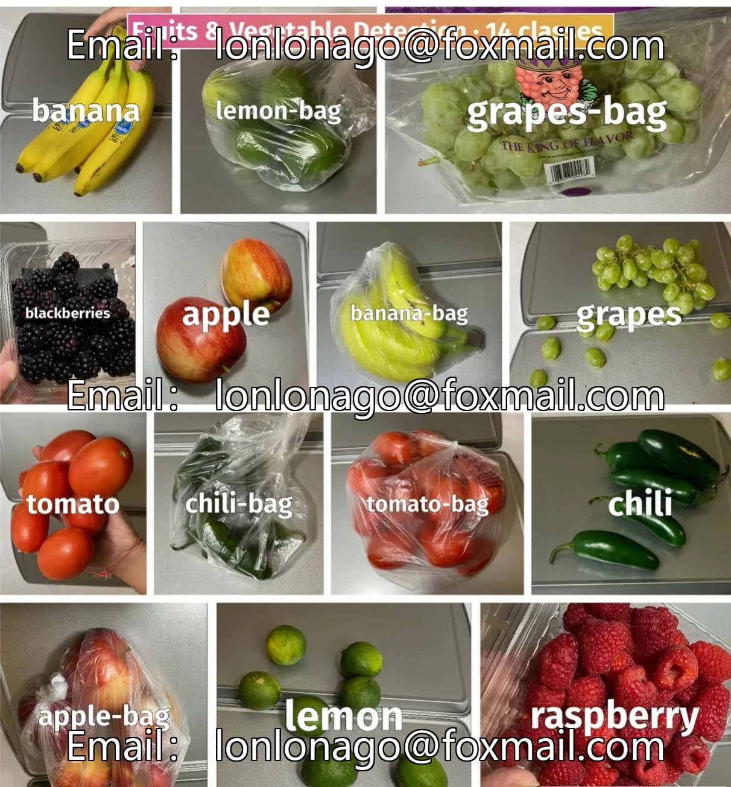
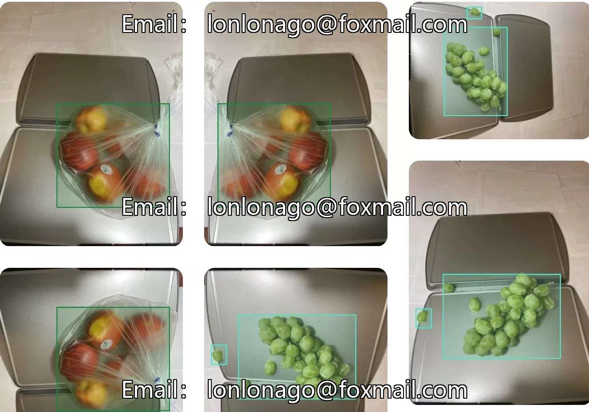
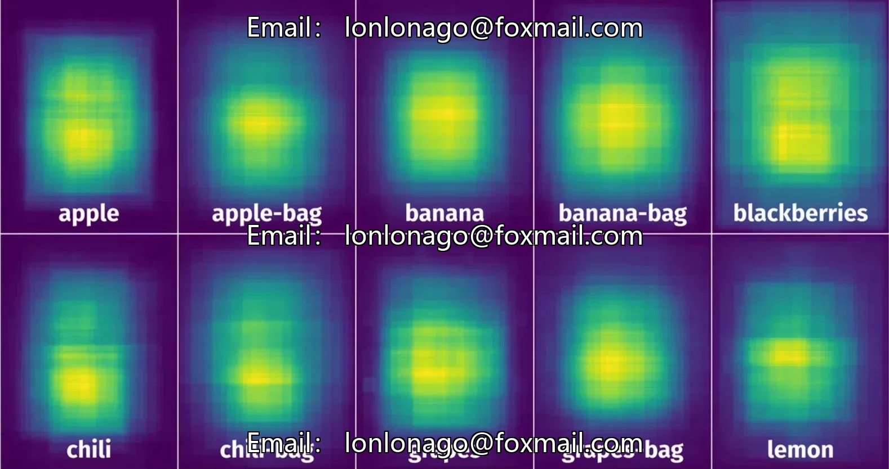
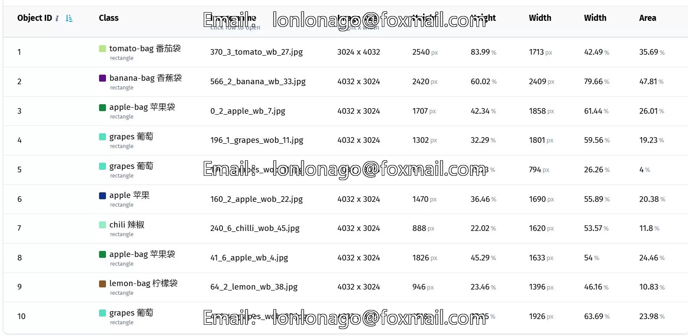
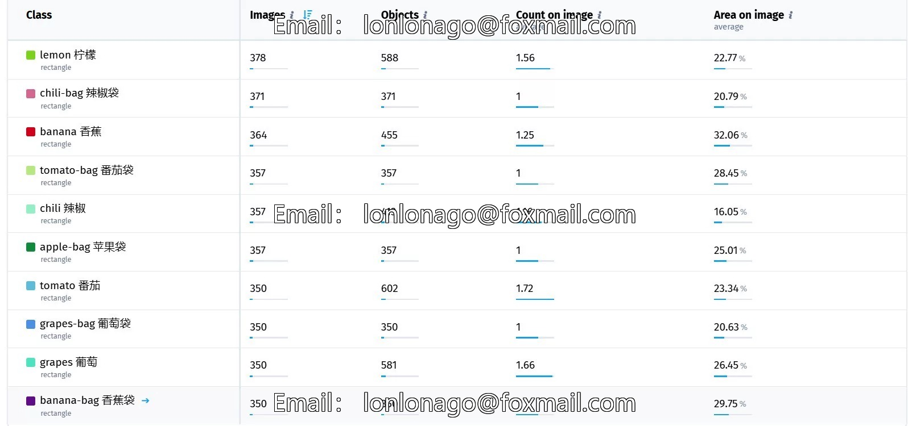

# Vegetable and fruit detection dataset - Yolo dataset

## Body

Vegetable and fruit detection dataset - Yolo dataset

Vegetable and fruit dataset
14 categories of fruits and vegetables with full coverage, including bananas, banana bags, blackberries, raspberries, lemons, lemon bags, grapes, grape bags, tomatoes, tomato bags, apples, apple bags, chilies, chili bags, etc. The dataset consists of 4592 images, 5628 annotated objects, 3942 training images, and 650 test images. The categories are balanced, suitable for training the YOLOv4 model, solving the problem of manual entry of loose fruits and vegetables during self-checkout, and enhancing checkout efficiency.

The data format is the raw images captured by iPhone 11, supporting bounding box annotation, recording object position and area, and table-style viewing. It can directly adapt to the training of YOLOv4 model and be applied in supermarket self-checkout scenarios.

Virtual materials, once sold, are non-refundable.
Interested friends, click "I want" to proceed.

## Images

## Payment

Here is a pay link on Stripe ( https://buy.stripe.com/3cs8yP7sY87d0vu9AB ). Please contact me lonlonago@foxmail.com after funding $89, and I will send you a complete data files , thank you!

